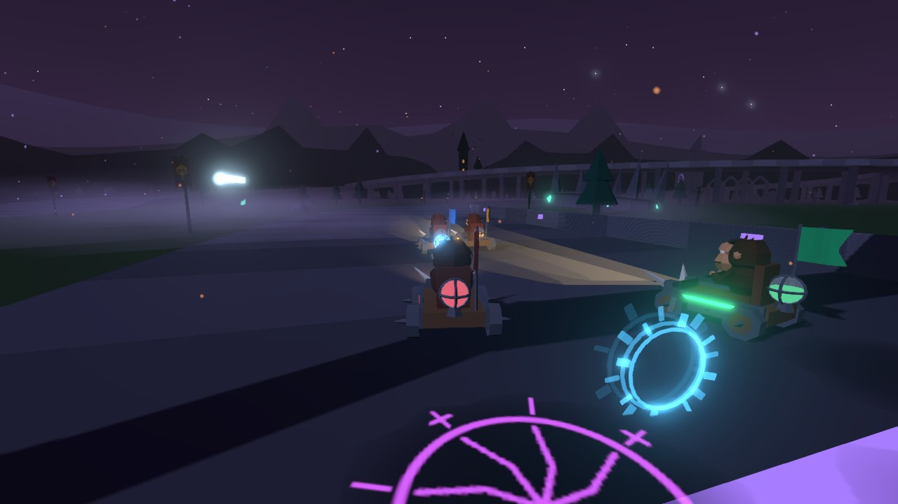
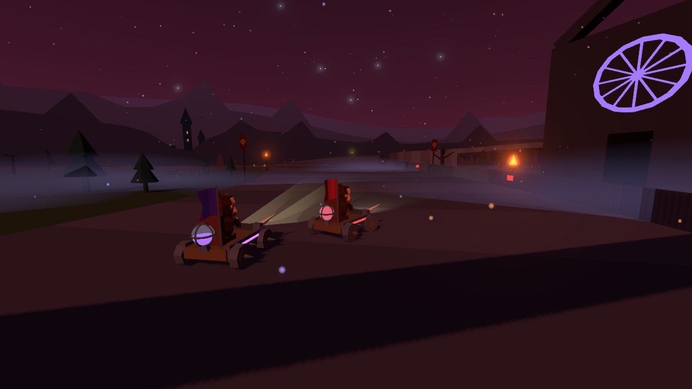
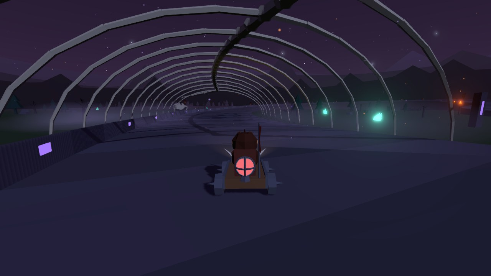
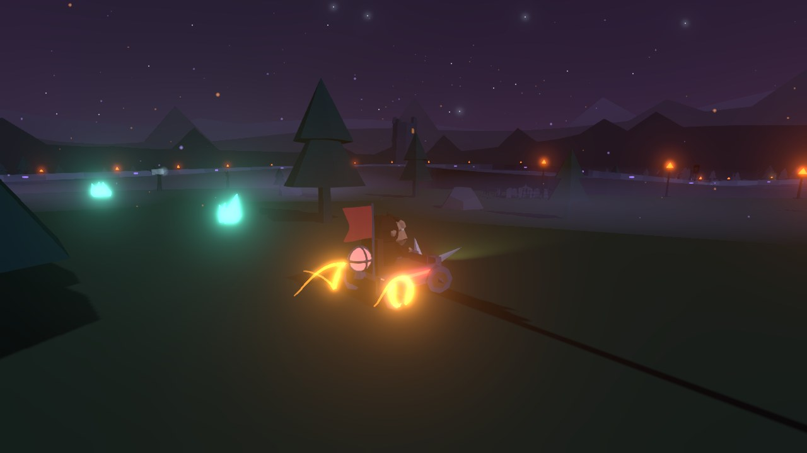
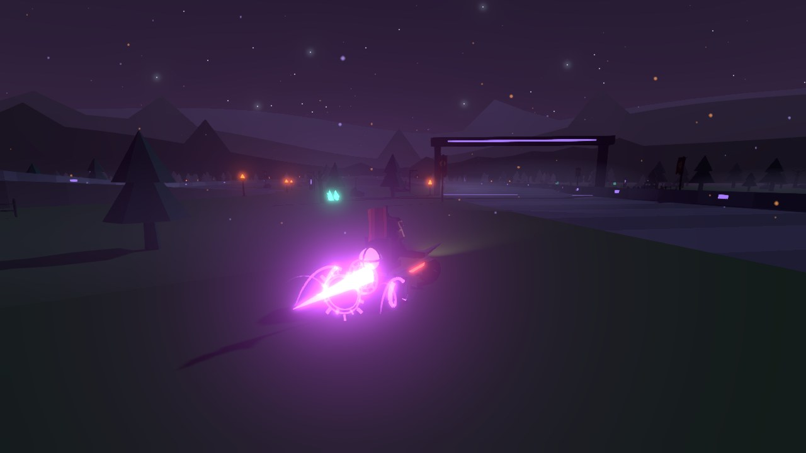
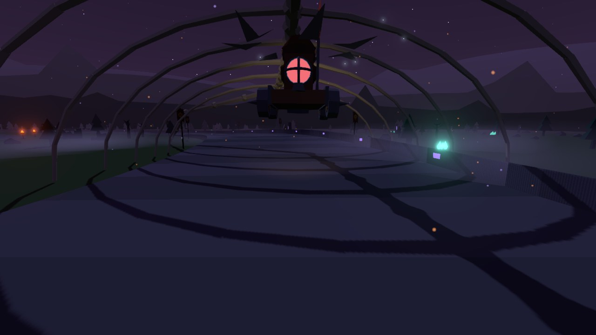
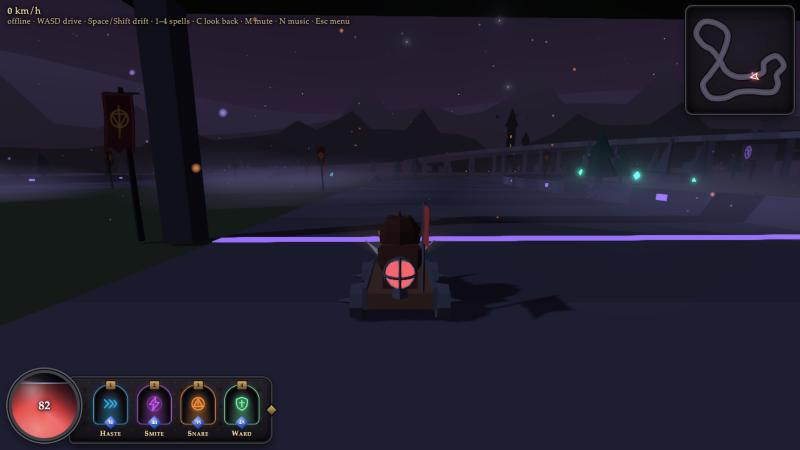
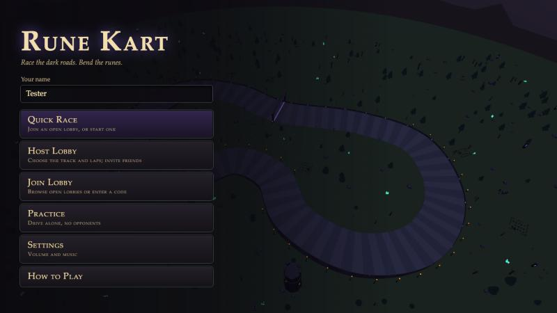

# Rune Kart

**A low-poly, dark-fantasy kart racer for the browser.** Race friends online or over your LAN, drift through
moonlit corners for rune-fuelled boosts, and cast spells from a mana orb instead of grabbing item boxes.



## Features

- **Multiplayer in the browser:** host a lobby or join with a room code; play against friends online or on your
  LAN, or fill the grid with bots. Server-authoritative netcode with client prediction, so your own kart always
  feels instant.
- **Drift boosts:** hold a drift through a corner and the sparks climb blue → orange → purple; let go for a boost
  with a flame and a rune sigil to match.
- **Spells, not items:** a mana orb refills as you race, faster while drifting and when you're behind. Spend it on
  four spells: Haste, Smite, Snare and Ward.
- **Three tracks:** each with its own landmark, from a ruined watchtower to a cathedral beside a high viaduct and
  a serpent's skeleton arching over the road.
- **A living night:** braziers at every corner, drifting ground mist, crows, lightning behind the mountains, ghost
  wisps, graveyards and gibbets, and a blood moon that rises on the final lap.
- **Crow rescue:** stray too far off the road and a flock of crows carries you back to where you left it.
- **All synthesised sound and music:** a soft kart-racer engine, cartoon drift, a score that follows the race,
  and recorded CC0 effects for the spells and hits.

## Screenshots

| | |
|:-:|:-:|
|  |  |
| **Blood moon:** the final lap turns the sky crimson | **Serpent's Pass:** racing through the ribs |
|  |  |
| **Drifting:** sparks climb blue → orange → purple | **Boosting:** the sigil is the boost's magical source |
|  |  |
| **Crow rescue:** stray too far and you're carried back | **The HUD:** mana orb, spell bar and minimap |

<p align="center"></p>

## Quick start

You need [Docker](https://docs.docker.com/get-docker/).

```bash
docker compose up -d --build
```

Then open **http://localhost:2567** (set `WEB_PORT` to use another port). From the menu you can start a
**Quick Race**, **Host** or **Join** a lobby, or **Practice** alone.

### Playing with friends

- **On your LAN:** friends open `http://<your-ip>:2567`. Start with
  `PUBLIC_ADDRESS=<your-ip>:2567 docker compose up -d` and the lobby shows that address for them.
- **Room links:** the address bar in a lobby is a link to it; share it, or give friends the room code for
  **Join Lobby**.
- **Desktop app (optional):** for hosting without Docker, `npm run desktop` runs it, and `npm run desktop:mac` /
  `desktop:win` build a DMG / portable .exe into `release/` (first `npm install --prefix electron`). It hosts the
  same server and shows your LAN address in the lobby.

## How to play

| Key | Action |
|---|---|
| **W A S D** / arrows | Drive and steer |
| **Space** / **Shift** | Drift: hold through a corner (before or after steering), release to boost |
| **1 2 3 4** | Cast Haste, Smite, Snare, Ward |
| **C** | Look back |
| **Enter** | Ready up in the lobby |
| **B** / **N**, **[** / **]** | Host only: add or remove a bot, fewer or more laps |
| **M** / **K** | Mute everything / music on or off (volume sliders are under **Settings**) |
| **Esc** | Back to the menu |

### Spells

Your mana orb (bottom left) holds 100 and refills in about 12 seconds, faster while you drift and when you're
behind.

| Spell | Mana | What it does |
|---|---|---|
| **Haste** | 30 | A burst of speed |
| **Smite** | 40 | A bolt that homes in on a kart ahead and spins it out |
| **Snare** | 35 | A rune trap dropped behind you; it stuns whoever drives over it |
| **Ward** | 45 | Blocks the next hit; it blinks just before it fades |

### Tracks

| Track | |
|---|---|
| **Moonlit Loop** | A long straight, sweeping bends and a raised hairpin under the castle and its ruined watchtower |
| **Hollow Crown** | The grand course: a figure-of-eight over a high viaduct beside a ruined cathedral, around a giant broken crown |
| **Serpent's Pass** | The longest run: tight S-bends over a ridge and through a serpent's skeleton. Short, sharp drifts |

## Development

```bash
npm install && npm run dev   # hot reload: Vite on :5173, server on :2567 (stop the container first)
npm test                     # tests for the shared simulation: physics, drifting, spells, bots, tracks
```

The project is an npm workspace:

| Folder | What's in it |
|---|---|
| `shared/` | The deterministic simulation both sides run: kart physics, spells, race progress, bots and the track builder. New tracks go in `shared/src/tracks.ts` and are tested automatically |
| `server/` | The [Colyseus](https://colyseus.io/) room: lobbies, the race loop, bots, and the authoritative simulation |
| `client/` | The [three.js](https://threejs.org/) game: rendering, effects, HUD, menu, sound and music |
| `electron/` | The optional desktop app |

Online, your kart is predicted locally and reconciled against the server, and the other karts are drawn 100 ms in
the past between server snapshots.

### Handy URLs and settings

- `/?practice&track=serpent` (or `/?offline`) drives solo with the simulation running locally. The console then
  exposes `KART` and `MANA` for live tuning (e.g. `KART.maxSpeed = 35`) and `me` (your kart's state).
- `/?quick`, `/?host&track=hollow&laps=3` and `/?join=<code>` jump straight into a game.
- `?autopilot` drives for you, which is handy for testing races solo; `?lag=150` simulates a 150 ms round trip on
  localhost.
- `LAPS=1 docker compose up -d` makes quick test races.

## Credits

- Spell, hit and boost sound effects from Kenney's [Sci-Fi Sounds](https://kenney.nl/assets/sci-fi-sounds) and
  [Impact Sounds](https://kenney.nl/assets/impact-sounds) packs (CC0); see `client/public/sfx/LICENSE.txt`.
- The engine, drift and race cues and all the music are synthesised in the browser (`client/src/audio.ts`,
  `client/src/music.ts`).
- Built with [three.js](https://threejs.org/), [Colyseus](https://colyseus.io/) and [Vite](https://vite.dev/).
- The original plan lives in [PLAN.md](PLAN.md).
